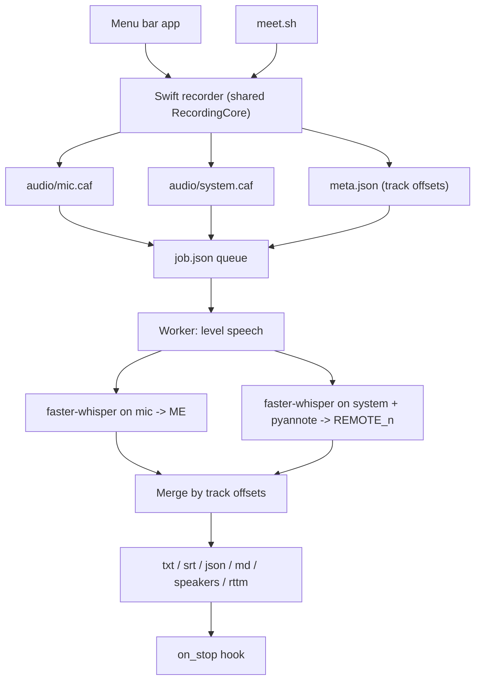

# MeetRec

Record and transcribe your Mac meetings locally: your voice and the other participants on separate tracks, with remote speakers told apart.

[](LICENSE)


<p align="center"></p>

## Why

Cloud meeting bots and transcription services send your audio off your machine.
A single mixed recording makes "who said what" unreliable.
MeetRec keeps everything on your Mac and records you and the other participants separately.

## Features

- Two separate tracks: the microphone (`audio/mic.caf`) and the whole system audio output via ScreenCaptureKit (`audio/system.caf`).
- Local transcription with `faster-whisper`; the two timelines are merged using the real track start offsets.
- Your voice is always labelled `ME`. Optional pyannote diarization runs on the system track only and labels remote speakers `REMOTE_01`, `REMOTE_02`, and so on.
- Menu bar app with language presets, elapsed timer, transcription progress and a macOS notification when a transcript is ready. Optional LaunchAgent to start it at login.
- Terminal recorder: `./meet.sh`.
- Persistent job queue with retries and recovery of interrupted jobs.
- Outputs: TXT, SRT, JSON, Markdown, per-speaker text, and RTTM when diarization ran.
- Optional `on_stop` hook that runs after the transcript is written.
- `doctor` command to check the installation.

## Quick start

Requirements:

- macOS 13 or later
- Xcode Command Line Tools (MeetRec compiles its Swift code locally; there is no prebuilt binary)
- Python 3.9+
- A Hugging Face read token, for remote-speaker diarization only
- About 4 GB of free disk and about 20 minutes

```bash
git clone https://github.com/frasal-test/meetrec.git
cd meetrec
xcode-select --install    # skip if `swiftc --version` already prints a version
python3 -m venv .venv
.venv/bin/pip install -r requirements-diarization.txt
echo 'HF_TOKEN=hf_your_token_here' > .env
```

Get the token at <https://huggingface.co/settings/tokens> (type: Read). While signed in, accept the conditions on both
[pyannote/segmentation-3.0](https://huggingface.co/pyannote/segmentation-3.0) and
[pyannote/speaker-diarization-3.1](https://huggingface.co/pyannote/speaker-diarization-3.1).

Create a self-signed code-signing certificate named `MeetRec Dev` in Keychain Access (Certificate Assistant, Create a Certificate, Identity Type: Self Signed Root, Certificate Type: Code Signing). Without it macOS asks for permissions again after every rebuild; see [Stable signing](#stable-signing). Then:

```bash
./meetrec.sh install
```

A ✒︎ icon appears in the menu bar. Start a recording from it and grant Microphone and Screen & System Audio Recording when macOS asks. Restart MeetRec so the screen grant takes effect, then check:

```bash
./meetrec.sh doctor
```

Without diarization: install `requirements.txt` instead of `requirements-diarization.txt`, skip the token, and set `"diarize_system": false` in the [config file](#configuration). With `diarize_system` left on and pyannote missing, transcripts are still produced, with a warning and every remote voice labelled `REMOTE`.

Wear headphones, otherwise your microphone picks up the other participants and they are transcribed twice.

[INSTALL.md](INSTALL.md) has the same steps one at a time, with expected output and troubleshooting.

## Usage

### Menu bar

```bash
./meetrec.sh run         # build and run in the foreground
./meetrec.sh install     # build, install a LaunchAgent (starts at login) and start it
./meetrec.sh uninstall   # disable the LaunchAgent (plist kept as .disabled)
./meetrec.sh build       # build only
./meetrec.sh doctor      # check the installation
```

The ✒︎ menu has:

- Start recording — Italiano / English / Español / Auto detect
- Stop recording
- Open recordings
- Run doctor
- Quit MeetRec

While recording, the menu shows the elapsed time. After Stop, the session is queued and transcribed in the background, so you can start another meeting meanwhile. The status item shows the percentage and the menu shows a progress bar with the current phase (phase names are in Italian), diarization included. A macOS notification appears when the job finishes.

### Terminal

```bash
./meet.sh [it|en|es|auto] [diar|nodiar] [num_speakers]
```

```bash
./meet.sh                # Italian, diarization on
./meet.sh en
./meet.sh es nodiar
./meet.sh auto nodiar
./meet.sh it diar 2      # expect two remote speakers
```

Press Enter to stop. Transcription is queued and continues in the background. To wait for it instead:

```bash
WAIT_FOR_TRANSCRIPT=1 ./meet.sh it diar 2
```

### Where files go

```text
recordings/
└── 2026-07-29T10-30-00/
    ├── meta.json                  # track offsets, duration, session state
    ├── job.json                   # queue state, attempts, options
    ├── transcribe.log
    ├── audio/
    │   ├── mic.caf
    │   └── system.caf
    └── transcripts/
        ├── transcript.txt
        ├── transcript.srt
        ├── transcript.json        # canonical: per-segment speaker, track, word timestamps
        ├── transcript.md
        ├── transcript.speakers.txt
        └── transcript.rttm        # only when diarization ran
```

The default location is `recordings/` in the project folder; see [Configuration](#configuration) before changing it.

Example of `transcript.md` (illustrative, not a real recording):

```markdown
**ME** · 00:00:01.200–00:00:04.800

Thanks for joining. Let's start with the release schedule.

**REMOTE_01** · 00:00:05.300–00:00:09.100

Sure. We are on track for the first of the month.
```

## Configuration

Everything is optional. The file is `~/.config/meetrec/config.json`; start from [`config.example.json`](config.example.json). `.venv/bin/python -m meeting_recorder.control show-config` prints the effective values.

```json
{
  "on_stop": "/path/to/archive-session",
  "transcription": {
    "model": "medium",
    "language": "it",
    "compute_type": "int8",
    "diarize_system": true
  }
}
```

| Key | Default | Meaning |
| --- | --- | --- |
| `recordings_dir` | `<project>/recordings` | Where the worker looks for sessions. Read this note first: [known bug](#recordings_dir-caveat). |
| `on_stop` | `null` | Shell command run after the transcripts are written. |
| `transcription.enabled` | `true` | `false` keeps the audio and skips transcription; `on_stop` still runs. |
| `transcription.model` | `"medium"` | Whisper model name. |
| `transcription.language` | `"it"` | Language code; `null` means auto-detect. |
| `transcription.compute_type` | `"int8"` | CTranslate2 compute type. `int8` is the fastest; `int8_float32` or `float32` are more accurate on a weak microphone. |
| `transcription.diarize_system` | `true` | Separate remote speakers with pyannote. |
| `transcription.word_timestamps` | `true` | Word-level timestamps in the JSON. |
| `transcription.max_attempts` | `3` | Retries before a job is marked failed. |
| `transcription.vad_filter` | `true` | Voice activity detection. |
| `transcription.hallucination_silence_threshold` | `2.0` | Seconds of silence after which a segment is dropped as a hallucination; `null` disables. |
| `transcription.condition_on_previous_text` | `true` | Condition each window on the previous one. |
| `transcription.normalize_audio` | `true` | Level speech before decoding. |
| `transcription.target_speech_dbfs` | `-20.0` | Target speech level. |

Menu bar presets always pass `--model medium` and `--language <preset>` to the worker, so `model` and `language` in the config file do not apply to menu bar recordings. For `meet.sh`, the model comes from `WHISPER_MODEL` and the language from its first argument.

### Environment variables

| Variable | Used by | Meaning |
| --- | --- | --- |
| `HF_TOKEN` or `HUGGINGFACE_TOKEN` | worker, `doctor` | Hugging Face token. Normally set in `.env` at the project root. |
| `RECORDINGS_DIR` | menu bar, `meet.sh` | Where new sessions are written. Default `<project>/recordings`. |
| `MEETREC_CONFIG` | `meet.sh` | Config file path. Default `~/.config/meetrec/config.json`. |
| `WHISPER_MODEL` | `meet.sh` | Whisper model. Default `medium`. |
| `WAIT_FOR_TRANSCRIPT` | `meet.sh` | `1` to transcribe synchronously. |
| `MEETREC_SIGN_IDENTITY` | `meetrec.sh` | Signing certificate name. Default `MeetRec Dev`. |

### `recordings_dir` caveat

`recordings_dir` in the config file is read only by the Python worker. The menu bar app and `meet.sh` write sessions to `RECORDINGS_DIR` or `<project>/recordings`. If the two differ, the worker never finds the recordings, so they are never transcribed, while the menu bar still says "Transcript ready". Tracked in [issue #1](https://github.com/frasal-test/meetrec/issues/1).

Until it is fixed, do not set `recordings_dir`. `config.example.json` sets it to `~/Recordings/MeetRec`: remove that line when you copy the file. Or set `RECORDINGS_DIR` to the same path.

### `on_stop` hook

Runs after all transcript files are written. The session directory is passed as `$1` and as `MEETREC_SESSION_DIR`. A failing hook is logged and the transcript is kept.

### Speech leveling and filtering

On by default, and designed to work together. The person wearing the microphone is silent for most of a meeting, and Whisper fed silence invents filler (one session produced 88 identical "Okay." segments over stretches at -80 dBFS). Filtering alone is not enough either: the VAD judges absolute energy, so a headset microphone recorded 17 dB below the system track lost 82% of the words actually spoken. Leveling first is what makes filtering safe.

- `normalize_audio` / `target_speech_dbfs`: bring speech in each track to the target level before decoding. The level is measured on speech only, with near-silent blocks excluded.
- `vad_filter`: keeps the decoder away from silence.
- `hallucination_silence_threshold`: backstop that drops segments produced after long silence.
- `condition_on_previous_text`: set to `false` if a recording gets stuck repeating a phrase.

## How it works

The menu bar app and `meet.sh` use the same Swift recording core (`RecordingCore.swift`) to capture the microphone and the system audio into two files, plus `meta.json` with the start offsets. Stopping a recording enqueues the session as a `job.json`. A single worker (guarded by a file lock) processes the queue: it levels the speech, transcribes the microphone track (labelled `ME`), transcribes the system track and runs pyannote on it (`REMOTE_n`), then merges both by their real start offsets and writes the outputs.



If pyannote is not installed or the Hugging Face token is refused, the session is still transcribed with every remote voice labelled `REMOTE`. The reason is written to `transcript.json` under `warnings` and printed at the top of the TXT, Markdown and speakers files. Other failures fail the job and are retried up to `max_attempts`.

## Advanced

### Stable signing

Without a signing certificate the build is ad-hoc signed. Its identity is the binary's own hash, which changes on every rebuild, so macOS asks for Microphone and Screen & System Audio Recording again and old entries pile up in Privacy settings.

1. Keychain Access, Certificate Assistant, Create a Certificate.
2. Name `MeetRec Dev`, Identity Type Self Signed Root, Certificate Type Code Signing.
3. Check that it is usable:

```bash
security find-identity -v -p codesigning
```

If it is not listed, open the certificate in Keychain Access, expand Trust, and set Code Signing to Always Trust. Use `MEETREC_SIGN_IDENTITY` for a different certificate name.

If MeetRec ran ad-hoc signed before, clear the stale grants, then rebuild and grant once more:

```bash
tccutil reset ScreenCapture com.frasal.meetrec.menubar
tccutil reset Microphone com.frasal.meetrec.menubar
```

`build` and `install` recompile only when the sources changed.

### Queue and recovery

```bash
.venv/bin/python -m meeting_recorder.control enqueue <session> [--force]
.venv/bin/python -m meeting_recorder.control process <session> [--force]   # synchronous
.venv/bin/python -m meeting_recorder.control recover                       # re-queue interrupted or never-queued sessions
.venv/bin/python -m meeting_recorder.control worker --once                 # process the pending queue
.venv/bin/python -m meeting_recorder.control doctor
.venv/bin/python -m meeting_recorder.control show-config
```

`enqueue` and `process` accept `--model`, `--language` (a code, or `auto`), `--diarize-system` / `--no-diarize-system` and `--num-speakers`. `--config <path>` goes before the subcommand. The menu bar app runs a recovery pass at launch. Jobs found in `processing` after an interrupted worker go back to `pending`.

### Re-transcribing

Safe to repeat: it overwrites `transcripts/` and never touches `audio/`.

```bash
.venv/bin/python -m meeting_recorder.control process recordings/2026-07-29T10-30-00 --force
```

## Known limitations

- macOS only, 13 or later.
- Build from source: no prebuilt binary and no notarized app. You create the self-signed certificate yourself.
- The system track captures all system audio (notifications and music included), not a single app.
- Without headphones, remote voices leak into the microphone and are transcribed twice.
- Transcription runs on the CPU; GPU acceleration is not used or tested.
- Diarization applies only to the system track. pyannote uses MPS when available.
- The first transcription downloads the `medium` model (1.4 GB, cached in `~/.cache/huggingface`); diarization adds 31 MB. The Python environment is about 1.1 GB.
- `recordings_dir` in the config file is ignored by the menu bar app and `meet.sh` ([#1](https://github.com/frasal-test/meetrec/issues/1)).
- The "Permissions as seen by this terminal" line of `doctor` describes Terminal, not MeetRec. Check System Settings, Privacy & Security.

## Privacy and legal

Processing is local. Models are downloaded once and cached. The `on_stop` hook is yours and may send data elsewhere. Recording meetings may require participant consent and compliance with company policy and applicable law.

## Acknowledgements

The two-track recording, recoverable sessions, background queue, menu bar workflow and post-processing hook were inspired by [digimata/quill](https://github.com/digimata/quill). MeetRec has its own implementation, built around `faster-whisper`, optional pyannote diarization and multi-format outputs.

## License

MIT. See [LICENSE](LICENSE).
