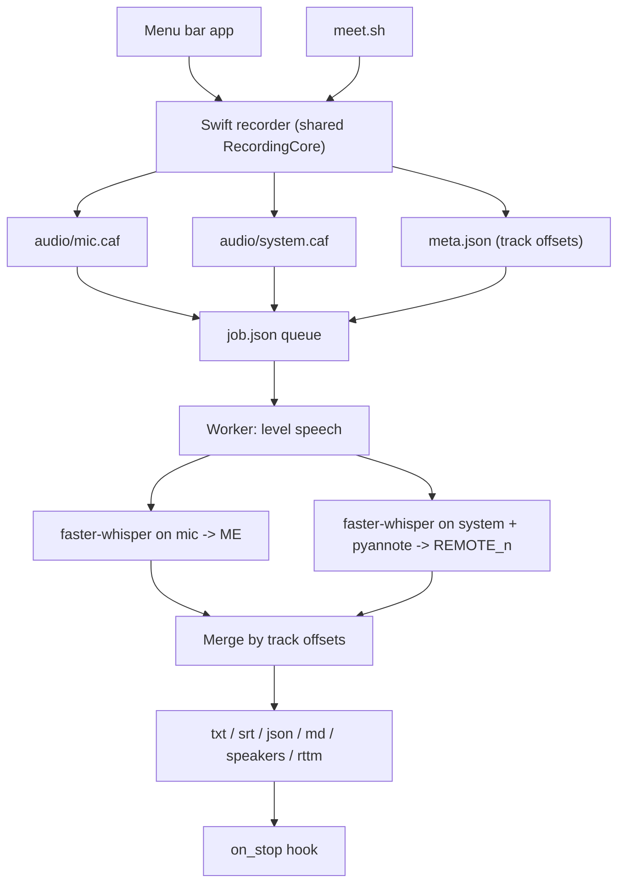

# MeetRec

Record and transcribe your Mac meetings locally: your voice and the other participants on separate tracks, with remote speakers told apart.

[](https://github.com/frasal-test/meetrec/actions/workflows/ci.yml)
[](LICENSE)


<p align="center"></p>

## Why

Cloud meeting bots and transcription services send your audio off your machine.
A single mixed recording makes "who said what" unreliable.
MeetRec keeps everything on your Mac and records you and the other participants separately.
The one exception is optional and off until you set it up: meeting summaries send the transcript text (never the audio) to an LLM service you choose.

## Features

- Two separate tracks: the microphone (`audio/mic.caf`) and the whole system audio output via ScreenCaptureKit (`audio/system.caf`).
- Local transcription with `faster-whisper`; the two timelines are merged using the real track start offsets.
- Your voice is always labelled `ME`. Optional pyannote diarization runs on the system track only and labels remote speakers `REMOTE_01`, `REMOTE_02`, and so on.
- Menu bar app with language presets, elapsed timer, transcription progress and a macOS notification when a transcript is ready. Optional LaunchAgent to start it at login.
- Terminal recorder: `./meet.sh`.
- Persistent job queue with retries and recovery of interrupted jobs.
- Outputs: Markdown and per-speaker text to read and share, plus TXT, SRT, JSON, and RTTM when diarization ran; see [Which file to use](#which-file-to-use).
- Optional `on_stop` hook that runs after the transcript is written.
- `doctor` command to check the installation: Python version, Apple Silicon, pyannote 4 and access to its models.
- Optional meeting summaries: after each transcript, send the text (never the audio) to an LLM you choose, Claude Haiku 5.5 (Anthropic), GPT-6 Luna (OpenAI) or gpt-oss-120b on Oracle OCI, and get a Markdown summary with participants, decisions, action items and open points. API keys stay in the macOS Keychain. See [Meeting summaries](#meeting-summaries-optional).

## Quick start

Requirements:

- Apple Silicon Mac. Intel Macs can transcribe but not separate speakers; see [Intel Macs](INSTALL.md#running-without-speaker-separation)
- macOS 13 or later
- About 4 GB of free disk (plus several GB for Apple's Command Line Tools if you do not have them) and about 20 minutes

**Before you start (optional, saves waiting):** to tell remote participants apart, MeetRec needs a free Hugging Face token. Getting one takes a few minutes in the browser:

1. Create an account at <https://huggingface.co/join>.
2. While signed in, accept the conditions on all three models: [segmentation-3.0](https://huggingface.co/pyannote/segmentation-3.0), [speaker-diarization-3.1](https://huggingface.co/pyannote/speaker-diarization-3.1), [speaker-diarization-community-1](https://huggingface.co/pyannote/speaker-diarization-community-1).
3. At <https://huggingface.co/settings/tokens>, create a token of type **Read** and copy it (it starts with `hf_`).

Without it ready, setup opens these pages for you and asks for the token after the long downloads, or you can skip it and add it later.

### One command

Open Terminal (`Cmd + Space`, type `Terminal`, Enter), paste this line and press Enter:

```bash
bash -c "$(curl -fsSL https://raw.githubusercontent.com/frasal-test/meetrec/main/setup.sh)"
```

[`setup.sh`](setup.sh) downloads MeetRec into `~/meetrec` and does every step below: Command Line Tools, Python (through [uv](https://docs.astral.sh/uv/) when no suitable one is installed), the Python packages, the token, the signing certificate, the build, the LaunchAgent and a final `doctor`. It talks in Italian on a Mac set to Italian and in English otherwise. You only act when macOS or Hugging Face require a person:

- click **Install** on the Command Line Tools dialog, if they are missing;
- paste the Hugging Face token, if you want speaker separation;
- type your Mac password when macOS asks to trust the signing certificate, and click **Always Allow** when `codesign` asks to use it;
- allow the Microphone and switch MeetRec on under Screen & System Audio Recording; setup tells you when and opens the right page.

Running the same line again updates MeetRec, and adds speaker separation if you skipped it. From inside a copy of the project, `./setup.sh` does the same without downloading it.

### By hand

The steps `setup.sh` automates, for those who want to see each one. [INSTALL.md](INSTALL.md) has them one at a time, with expected output and troubleshooting.

1. Install the Command Line Tools first; without them `git` and `python3` are stubs. Wait for the installer to finish; an "already installed" error is fine.

   ```bash
   xcode-select --install
   ```

2. Install Python 3.12. Both routes give you a `python3.12` command.

   ```bash
   brew install python@3.12
   ```

   Without Homebrew, download Python 3.12.10 from <https://www.python.org/downloads/release/python-31210/>, open the `.pkg` and click through. python.org's newer 3.12.x releases are security-only and ship no macOS installer; 3.12.10 is the last 3.12 release that has one.

3. Download MeetRec and install its Python packages (Intel Mac: `requirements.txt` instead; see below):

   ```bash
   git clone https://github.com/frasal-test/meetrec.git
   cd meetrec
   python3.12 -m venv .venv
   .venv/bin/python -m pip install -U pip
   .venv/bin/python -m pip install -r requirements-diarization.txt
   ```

4. Get a token at <https://huggingface.co/settings/tokens> (a Read token; a fine-grained token needs "Read access to contents of all public gated repos you can access"). While signed in, accept the conditions on all three models:

   - [pyannote/segmentation-3.0](https://huggingface.co/pyannote/segmentation-3.0)
   - [pyannote/speaker-diarization-3.1](https://huggingface.co/pyannote/speaker-diarization-3.1)
   - [pyannote/speaker-diarization-community-1](https://huggingface.co/pyannote/speaker-diarization-community-1)

   Then save the token, replacing only `hf_your_token_here`:

   ```bash
   echo 'HF_TOKEN=hf_your_token_here' > .env
   ```

5. Create a self-signed code-signing certificate named `MeetRec Dev` in Keychain Access (Certificate Assistant, Create a Certificate, Identity Type: Self Signed Root, Certificate Type: Code Signing). Without it macOS asks for permissions again after every rebuild. It is valid for a year by default; see [Stable signing](#stable-signing) to make it last longer.

6. Build and install:

   ```bash
   ./meetrec.sh install
   ```

   The first time, macOS may ask whether `codesign` can use the key "MeetRec Dev". Enter your login password and click Always Allow (it can appear twice). Terminal looks stuck until you answer.

7. The MeetRec icon (a microphone between sound bars) appears in the menu bar. Start a recording from it and allow Microphone. The first attempt shows "Recording failed"; that is expected, because macOS grants screen recording only after the app restarts. Enable MeetRec in System Settings → Privacy & Security → Screen & System Audio Recording (called Screen Recording on macOS 13 and 14), then restart it: MeetRec menu → Quit MeetRec, then

   ```bash
   ./meetrec.sh install
   ```

8. Check the installation. Every check line should start with ✓; ignore the "Permissions as seen by this terminal" line under them, because it describes Terminal, not MeetRec:

   ```bash
   ./meetrec.sh doctor
   ```

Without diarization (also the only option on Intel Macs): install `requirements.txt` instead of `requirements-diarization.txt`, skip the token, write the setting below, and restart MeetRec. With `diarize_system` left on and pyannote missing, transcripts are still produced, with a warning and every remote voice labelled `REMOTE`.

```bash
mkdir -p ~/.config/meetrec
echo '{"transcription": {"diarize_system": false}}' > ~/.config/meetrec/config.json
```

Updating later: run the setup command again, or by hand `git pull`, then `.venv/bin/python -m pip install -U -r requirements-diarization.txt` (`requirements.txt` without speaker separation), then `./meetrec.sh install`.

Wear headphones, otherwise your microphone picks up the other participants and they are transcribed twice.

## Usage

### Menu bar

```bash
./meetrec.sh run         # build and run in the foreground
./meetrec.sh install     # build, install a LaunchAgent (starts at login) and start it
./meetrec.sh uninstall   # disable the LaunchAgent (plist kept as .disabled)
./meetrec.sh build       # build only
./meetrec.sh doctor      # check the installation
```

The MeetRec menu has:

- About MeetRec
- Start recording — Italiano / English / Español / Auto detect
- Stop recording
- Open recordings
- Open last summary, and Open emergency summary when there is one
- Run doctor
- Settings… (API keys and Automatic Summary, see [Meeting summaries](#meeting-summaries-optional))
- Ask about participants before recording (on by default)
- Delete audio after a clean transcript (off by default)
- Quit MeetRec

Before every recording MeetRec asks "Have you told the participants?" in the language of the preset (English for Auto detect). "Copy notice and record" also puts a short notice on the clipboard, ready to paste into the meeting chat. Ticking "Don't ask again" turns the question off; the menu item turns it back on. See [Responsible use](#responsible-use).

While recording, the icon's right-hand sound bar becomes a dot and the elapsed time appears next to it. After Stop, the session is queued and transcribed in the background, so you can start another meeting meanwhile. The icon shows the percentage, then ✓ (or ! if the job failed), and the menu shows a progress bar with the current phase, diarization included. A macOS notification appears when the job finishes.

### Terminal

```bash
./meet.sh [it|en|es|auto] [diar|nodiar] [num_speakers]
```

```bash
./meet.sh                # Italian, speaker separation as configured
./meet.sh en
./meet.sh es nodiar
./meet.sh auto nodiar
./meet.sh it diar 2      # expect two remote speakers
```

`diar` and `nodiar` override the `diarize_system` setting of the config file for that recording; without them the config decides. Recordings started from Terminal use Terminal's permissions, not MeetRec's, so Terminal itself needs Microphone and Screen Recording access.

Press Enter to stop. Transcription is queued and continues in the background. To wait for it instead:

```bash
WAIT_FOR_TRANSCRIPT=1 ./meet.sh it diar 2
```

### Where files go

```text
recordings/
└── 2026-07-29T10-30-00/
    ├── meta.json                  # track offsets, duration, session state
    ├── job.json                   # queue state, attempts, options
    ├── transcribe.log             # short status lines; the menu bar worker logs to recordings/.menubar.log
    ├── llm.log                    # summary runs: state changes, tokens and cost (never keys or text)
    ├── audio/
    │   ├── mic.caf
    │   └── system.caf
    ├── transcripts/
    │   ├── transcript.txt
    │   ├── transcript.srt
    │   ├── transcript.json        # canonical: per-segment speaker, track, word timestamps
    │   ├── transcript.md
    │   ├── transcript.speakers.txt
    │   └── transcript.rttm        # only when diarization ran
    └── summaries/                 # only when you made a summary
        ├── <run_id>.md            # the summary to read
        └── <run_id>.json          # the same, with model, template, tokens and cost
```

The default location is `recordings/` in the project folder; see [Configuration](#configuration) before changing it.

### Which file to use

Two files are meant for people, and they hold the same conversation:

| You want to | Use | Looks like |
| --- | --- | --- |
| Read the meeting | `transcripts/transcript.md` | Speaker and time as a heading, then what they said. Opens nicely in any Markdown viewer. |
| Paste it into a document, an email or an AI assistant for minutes | `transcripts/transcript.speakers.txt` | One line per turn: `[00:00:05.300 - 00:00:09.100] REMOTE_01: Sure. We are on track…` |

Both are the same with or without speaker separation; only the labels change. With it, remote participants are `REMOTE_01`, `REMOTE_02`, and so on; without it they are all `REMOTE`. Your voice is always `ME`.

**`transcript.txt` is not the one to share:** it is the bare text, with no speakers and no times, so you cannot tell who said what. The rest are for tools: `transcript.srt` subtitles a video player, `transcript.json` carries everything (word timings, tracks, warnings) for scripts and `on_stop` hooks, and `transcript.rttm` is the raw speaker separation for diarization tools.

When something was switched off, for example speaker separation because the token was refused, the transcript still comes out complete and `transcript.md` and `transcript.speakers.txt` start with a line saying so.

Example of `transcript.md` (illustrative, not a real recording):

```markdown
**ME** · 00:00:01.200–00:00:04.800

Thanks for joining. Let's start with the release schedule.

**REMOTE_01** · 00:00:05.300–00:00:09.100

Sure. We are on track for the first of the month.
```

### Meeting summaries (optional)

MeetRec can turn a transcript into a short summary with an LLM in the cloud. It is off until you save an API key in **Settings…**, and nothing is sent anywhere before that.

**What leaves your Mac.** Only the text of `transcript.speakers.txt`, never the audio. From then on, the text is governed by the chosen service's terms of use, privacy policy and any agreement you have with it (SLA, DPA), not by MeetRec. Check them before using it for confidential meetings. Settings keeps this notice on screen.

**Services.** One model per service; you need an account and an API key for at least one. [INSTALL.md](INSTALL.md#step-12--optional-meeting-summaries-with-an-llm) explains how to get them.

| Service | Model | Price per million tokens (in / out) |
| --- | --- | --- |
| Anthropic | Claude Haiku 5.5 | $0.10 / $0.50 |
| OpenAI | GPT-6 Luna | $0.10 / $0.50 |
| Oracle OCI (Generative AI) | gpt-oss-120b | $0.15 / $0.60 |

Prices are the ones built into this version, in USD; the service's own price list is what you pay. A one-hour meeting usually costs well under one cent.

**How it works.** When a transcript is ready, a window asks what to do with it: a model, each with its maximum estimated cost, or **None** (keep the transcript only), and the response language (Ita, Eng, Esp, or Auto for the language of the transcript). Nothing is preselected. **Start** sends the text; the menu shows "Summarizing with …" and a notification tells you when the summary is saved. Click it, or use **Open last summary**, to open it. Closing the window is the same as None.

**Automatic Summary.** In Settings you can tick Automatic Summary and pick a model: every transcript is then summarized with it, in the language of the transcript, without the window. If you later remove that model's key, the window comes back when another service still has one.

**The summary.** `summaries/<run_id>.md` in the session folder, with five sections (Summary, Participants, Decisions, Action items, Open points) in the response language, and a header with the service, model, date and real cost. Participants are named only when the transcript says their names; otherwise they stay `ME`, `REMOTE_01` and so on. Every run makes new files; nothing is overwritten.

**When it does not run.**

- Transcripts under 150 words are not summarized: read them directly.
- Transcripts too long for every model (beyond about 90,000 tokens, roughly five hours of speech) are not sent. A model whose context is too small for the transcript is shown greyed out.
- A timeout, a lost connection, too many requests or a service that is down offer **Retry** once. Other errors (a key that no longer works, no credit left) end with a message. In every case the transcript was saved first.
- If the summary cannot be written into the session folder, it is saved to `~/Library/Application Support/MeetRec/emergency/<run_id>.json` instead, and the menu shows **Open emergency summary**.

**API keys.** Each key is checked with the service when you save it; a key that is refused is not saved, and the one you had stays. Keys live in the macOS Keychain, one item per service (`com.frasal.meetrec.llm`), and are read only after you pick a model, and only for that service. After each update macOS asks once for your login password to let the new build read the key; choose **Always Allow**. **Remove** deletes a key.

## Configuration

Everything is optional. The file is `~/.config/meetrec/config.json`; start from [`config.example.json`](config.example.json). `.venv/bin/python -m meeting_recorder.control show-config` prints the effective values.

```json
{
  "on_stop": "/path/to/archive-session",
  "transcription": {
    "model": "medium",
    "language": "it",
    "compute_type": "int8",
    "diarize_system": true
  }
}
```

| Key | Default | Meaning |
| --- | --- | --- |
| `recordings_dir` | `<project>/recordings` | Where sessions are written and where the worker looks for them. `RECORDINGS_DIR` overrides it. Not in `config.example.json`; add it only to move recordings. |
| `on_stop` | `null` | Shell command run after the transcripts are written. |
| `delete_audio_after_transcription` | `false` | Delete `audio/` once the transcript is written, but only when the job completed, the transcript has text and it has no warnings; otherwise the audio is kept so the session can be transcribed again. The menu item of the same name sets it; so does `meeting_recorder.control delete-audio on\|off`. Applies to `meet.sh` recordings too. |
| `transcription.enabled` | `true` | `false` keeps the audio and skips transcription; `on_stop` still runs. |
| `transcription.model` | `"medium"` | Whisper model name. |
| `transcription.language` | `"it"` | Language code; `null` means auto-detect. |
| `transcription.compute_type` | `"int8"` | CTranslate2 compute type. `int8` is the fastest; `int8_float32` or `float32` are more accurate on a weak microphone. |
| `transcription.diarize_system` | `true` | Separate remote speakers with pyannote. |
| `transcription.word_timestamps` | `true` | Word-level timestamps in the JSON. |
| `transcription.max_attempts` | `3` | Retries before a job is marked failed. |
| `transcription.vad_filter` | `true` | Voice activity detection. |
| `transcription.hallucination_silence_threshold` | `2.0` | Seconds of silence after which a segment is dropped as a hallucination; `null` disables. |
| `transcription.condition_on_previous_text` | `true` | Condition each window on the previous one. |
| `transcription.normalize_audio` | `true` | Level speech before decoding. |
| `transcription.target_speech_dbfs` | `-20.0` | Target speech level. |

Menu bar presets always pass `--model medium` and `--language <preset>` to the worker, so `model` and `language` in the config file do not apply to menu bar recordings. For `meet.sh`, the model comes from `WHISPER_MODEL` and the language from its first argument.

### Environment variables

| Variable | Used by | Meaning |
| --- | --- | --- |
| `HF_TOKEN` or `HUGGINGFACE_TOKEN` | worker, `doctor` | Hugging Face token. Normally set in `.env` at the project root. |
| `RECORDINGS_DIR` | menu bar, `meet.sh`, worker | Where sessions are written and read. Overrides `recordings_dir`; default `<project>/recordings`. A shell `export` does not reach the menu bar app; put `RECORDINGS_DIR=...` in `.env` instead. |
| `MEETREC_CONFIG` | `meet.sh` | Config file path. Default `~/.config/meetrec/config.json`. |
| `WHISPER_MODEL` | `meet.sh` | Whisper model. Default `medium`. |
| `WAIT_FOR_TRANSCRIPT` | `meet.sh` | `1` to transcribe synchronously. |
| `MEETREC_SIGN_IDENTITY` | `meetrec.sh` | Signing certificate name. Default `MeetRec Dev`. |
| `PYANNOTE_METRICS_ENABLED` | worker, `doctor` | MeetRec sets it to `false` so pyannote sends no usage metrics; set to `true` to opt in. |

### Where recordings go

The menu bar app, `meet.sh` and the worker all ask the same place, `meeting_recorder.control recordings-dir`, so they always agree. The order is `RECORDINGS_DIR`, then `recordings_dir` in the config file, then `<project>/recordings`. The menu bar app reads the default config file only; `MEETREC_CONFIG` applies to `meet.sh`.

### `on_stop` hook

Runs after all transcript files are written. The session directory is passed as `$1` and as `MEETREC_SESSION_DIR`. A failing hook is logged and the transcript is kept.

### Speech leveling and filtering

On by default, and designed to work together. The person wearing the microphone is silent for most of a meeting, and Whisper fed silence invents filler (one session produced 88 identical "Okay." segments over stretches at -80 dBFS). Filtering alone is not enough either: the VAD judges absolute energy, so a headset microphone recorded 17 dB below the system track lost 82% of the words actually spoken. Leveling first is what makes filtering safe.

- `normalize_audio` / `target_speech_dbfs`: bring speech in each track to the target level before decoding. The level is measured on speech only, with near-silent blocks excluded.
- `vad_filter`: keeps the decoder away from silence.
- `hallucination_silence_threshold`: backstop that drops segments produced after long silence.
- `condition_on_previous_text`: set to `false` if a recording gets stuck repeating a phrase.

## How it works

The menu bar app and `meet.sh` use the same Swift recording core (`RecordingCore.swift`) to capture the microphone and the system audio into two files, plus `meta.json` with the start offsets. Stopping a recording enqueues the session as a `job.json`. A single worker (guarded by a file lock) processes the queue: it levels the speech, transcribes the microphone track (labelled `ME`), transcribes the system track and runs pyannote on it (`REMOTE_n`), then merges both by their real start offsets and writes the outputs.



After the transcript is written, the menu bar app starts the optional summary in a separate process (`python -m meeting_recorder.control llm-run <session>`), outside the transcription queue. The app shows the choice and retry windows and reads the Keychain; the Python process builds the prompt, calls the service and saves the result.

If pyannote is not installed or the Hugging Face token is refused, the session is still transcribed with every remote voice labelled `REMOTE`. The reason is written to `transcript.json` under `warnings` and printed at the top of the TXT, Markdown and speakers files. Other failures fail the job and are retried up to `max_attempts`.

## Advanced

### Stable signing

Without a signing certificate the build is ad-hoc signed. Its identity is the binary's own hash, which changes on every rebuild, so macOS asks for Microphone and Screen & System Audio Recording again and old entries pile up in Privacy settings.

1. Keychain Access, Certificate Assistant, Create a Certificate.
2. Name `MeetRec Dev`, Identity Type Self Signed Root, Certificate Type Code Signing. The default validity is 365 days; after that the build silently falls back to ad-hoc signing and macOS asks for permissions again. Tick "Let me override defaults" and set a longer validity period (for example 3650 days) to avoid it.
3. Check that it is usable:

```bash
security find-identity -v -p codesigning
```

If it is not listed, open the certificate in Keychain Access, expand Trust, and set Code Signing to Always Trust. Use `MEETREC_SIGN_IDENTITY` for a different certificate name.

If MeetRec ran ad-hoc signed before, clear the stale grants, then rebuild and grant once more:

```bash
tccutil reset ScreenCapture com.frasal.meetrec.menubar
tccutil reset Microphone com.frasal.meetrec.menubar
```

`build` and `install` recompile only when the sources changed.

### Queue and recovery

Run these from the project folder.

```bash
.venv/bin/python -m meeting_recorder.control enqueue <session> [--force]
.venv/bin/python -m meeting_recorder.control process <session> [--force]   # synchronous
.venv/bin/python -m meeting_recorder.control recover                       # re-queue interrupted or never-queued sessions
.venv/bin/python -m meeting_recorder.control worker --once                 # process the pending queue
.venv/bin/python -m meeting_recorder.control doctor
.venv/bin/python -m meeting_recorder.control show-config
```

`enqueue` and `process` accept `--model`, `--language` (a code, or `auto`), `--diarize-system` / `--no-diarize-system` and `--num-speakers`. `--config <path>` goes before the subcommand. The menu bar app runs a recovery pass at launch. Jobs found in `processing` after an interrupted worker go back to `pending`.

### Logs

The menu bar app writes the worker output (model download, per-segment lines, pyannote access help, tracebacks) to `recordings/.menubar.log`. Each session's `transcribe.log` only gets short status lines. For `meet.sh`, the background worker writes to the session's `transcribe.log`.

Each summary run writes its steps, tokens and cost to the session's `llm.log`, never the keys or the text. Notification problems (for example, notifications turned off for MeetRec) go to `recordings/.menubar.log`.

### Re-transcribing

Safe to repeat: it overwrites `transcripts/` and never touches `audio/`. It needs the audio, so it is not possible for a session whose audio was deleted by `delete_audio_after_transcription`.

```bash
.venv/bin/python -m meeting_recorder.control process recordings/2026-07-29T10-30-00 --force
```

## Known limitations

- macOS only, 13 or later, on Apple Silicon. Intel Macs get transcription but no speaker separation: PyTorch 2.8, which pyannote 4 needs, has no Intel build.
- Python 3.10 to 3.13. Python 3.14 works only on Apple Silicon with macOS 14 or later; not on macOS 13 or Intel.
- Build from source: no prebuilt binary and no notarized app. You create the self-signed certificate yourself.
- The system track captures all system audio (notifications and music included), not a single app.
- Without headphones, remote voices leak into the microphone and are transcribed twice.
- Transcription runs on the CPU; GPU acceleration is not used or tested.
- Diarization applies only to the system track. pyannote uses MPS when available.
- The first transcription downloads the `medium` model (about 1.5 GB, cached in `~/.cache/huggingface`); diarization adds about 32 MB. The Python environment is about 1 GB.
- The "Permissions as seen by this terminal" line of `doctor` describes Terminal when run from Terminal, not MeetRec. The menu's Run doctor shows MeetRec's own checks in a window, with a button to open the full output in `recordings/.menubar.log`.
- The first recording always fails until you enable Screen & System Audio Recording for MeetRec and restart it.
- The summary models and their prices are built into each version. When a service retires a model, summaries with it fail with "Model no longer available" until you update MeetRec.
- pyannote may print a "torchcodec is not installed correctly" warning when FFmpeg is absent. It is harmless; MeetRec passes audio in memory.

## Privacy and legal

Recording and transcription are local. Meeting summaries, if you set them up, send the transcript text (never the audio) to the service you choose; see [Meeting summaries](#meeting-summaries-optional). Models are downloaded from Hugging Face once and cached. MeetRec turns off pyannote's usage telemetry by default (`PYANNOTE_METRICS_ENABLED=false`). The `on_stop` hook is yours and may send data elsewhere.

### Responsible use

MeetRec is a recording tool, like a dictaphone: whether a recording is lawful depends on where you are, who is in the meeting and what you do with it, and that responsibility is yours. This is not legal advice. MeetRec is designed to stay inside the following boundary, and you should too:

1. **Record only meetings you take part in.** MeetRec records your own microphone and your own Mac's audio output; it never joins a call on its own.
2. **Tell everyone at the start.** Say it aloud (it then ends up in the recording itself) or paste the notice MeetRec copies for you. Several jurisdictions, including Germany and US states such as California, Florida, Illinois, Pennsylvania and Washington, require the consent of every participant. Telling everyone and letting them object satisfies the strictest rules almost everywhere.
3. **Keep it local.** Audio and transcripts never leave your Mac unless you send them somewhere, for example with `on_stop`.
4. **Use it for notes and minutes.** Not to monitor employees, not to publish, not to collect material behind someone's back.
5. **Keep remote speakers anonymous.** Speaker separation labels voices `REMOTE_01`, `REMOTE_02` and stores no voice embeddings or voiceprints, so no one is identified by their voice.

Keep only what you need: turn on "Delete audio after a clean transcript" if the text is enough for you. Your employer's policy may add rules of its own.

## Acknowledgements

The two-track recording, recoverable sessions, background queue, menu bar workflow and post-processing hook were inspired by [digimata/quill](https://github.com/digimata/quill). MeetRec has its own implementation, built around `faster-whisper`, optional pyannote diarization and multi-format outputs.

## License

Copyright (C) 2026 frasal-test

MeetRec is free software, released under the [GNU General Public License v3.0](LICENSE). You can use, study, change and share it. If you distribute it, modified or not, you must make the source available under the same license.

Versions up to and including v0.9.1 were released under the MIT License, and copies of those versions keep it. Everything after v0.9.1 is GPL-3.0.
