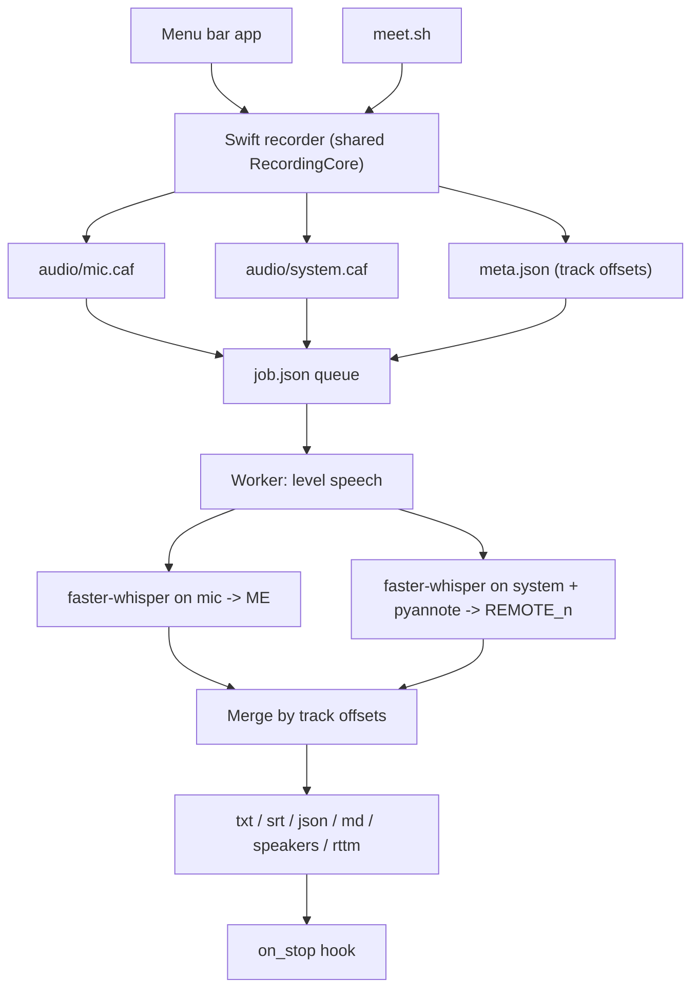

# MeetRec

Record and transcribe your Mac meetings locally: your voice and the other participants on separate tracks, with remote speakers told apart.

[](LICENSE)


<p align="center"></p>

## Why

Cloud meeting bots and transcription services send your audio off your machine.
A single mixed recording makes "who said what" unreliable.
MeetRec keeps everything on your Mac and records you and the other participants separately.

## Features

- Two separate tracks: the microphone (`audio/mic.caf`) and the whole system audio output via ScreenCaptureKit (`audio/system.caf`).
- Local transcription with `faster-whisper`; the two timelines are merged using the real track start offsets.
- Your voice is always labelled `ME`. Optional pyannote diarization runs on the system track only and labels remote speakers `REMOTE_01`, `REMOTE_02`, and so on.
- Menu bar app with language presets, elapsed timer, transcription progress and a macOS notification when a transcript is ready. Optional LaunchAgent to start it at login.
- Terminal recorder: `./meet.sh`.
- Persistent job queue with retries and recovery of interrupted jobs.
- Outputs: TXT, SRT, JSON, Markdown, per-speaker text, and RTTM when diarization ran.
- Optional `on_stop` hook that runs after the transcript is written.
- `doctor` command to check the installation: Python version, Apple Silicon, pyannote 4 and access to its models.

## Quick start

Requirements:

- Apple Silicon Mac. Intel Macs can transcribe but not separate speakers; see [Intel Macs](INSTALL.md#running-without-speaker-separation)
- macOS 13 or later
- Xcode Command Line Tools (MeetRec compiles its Swift code locally; there is no prebuilt binary)
- Python 3.10 to 3.13, 3.12 recommended. The `python3` bundled with the Command Line Tools is 3.9 and too old
- A Hugging Face read token, for remote-speaker diarization only
- About 4 GB of free disk (plus the Command Line Tools) and about 20 minutes

1. Install the Command Line Tools first; without them `git` and `python3` are stubs. Wait for the installer to finish; an "already installed" error is fine.

   ```bash
   xcode-select --install
   ```

2. Install Python 3.12. Both routes give you a `python3.12` command.

   ```bash
   brew install python@3.12
   ```

   Without Homebrew, download Python 3.12.10 from <https://www.python.org/downloads/release/python-31210/>, open the `.pkg` and click through. python.org's newer 3.12.x releases are security-only and ship no macOS installer; 3.12.10 is the last 3.12 release that has one.

3. Download MeetRec and install its Python packages (Intel Mac: `requirements.txt` instead; see below):

   ```bash
   git clone https://github.com/frasal-test/meetrec.git
   cd meetrec
   python3.12 -m venv .venv
   .venv/bin/python -m pip install -U pip
   .venv/bin/python -m pip install -r requirements-diarization.txt
   ```

4. Get a token at <https://huggingface.co/settings/tokens> (a Read token; a fine-grained token needs "Read access to contents of all public gated repos you can access"). While signed in, accept the conditions on all three models:

   - [pyannote/segmentation-3.0](https://huggingface.co/pyannote/segmentation-3.0)
   - [pyannote/speaker-diarization-3.1](https://huggingface.co/pyannote/speaker-diarization-3.1)
   - [pyannote/speaker-diarization-community-1](https://huggingface.co/pyannote/speaker-diarization-community-1)

   Then save the token, replacing only `hf_your_token_here`:

   ```bash
   echo 'HF_TOKEN=hf_your_token_here' > .env
   ```

5. Create a self-signed code-signing certificate named `MeetRec Dev` in Keychain Access (Certificate Assistant, Create a Certificate, Identity Type: Self Signed Root, Certificate Type: Code Signing). Without it macOS asks for permissions again after every rebuild. It is valid for a year by default; see [Stable signing](#stable-signing) to make it last longer.

6. Build and install:

   ```bash
   ./meetrec.sh install
   ```

   The first time, macOS may ask whether `codesign` can use the key "MeetRec Dev". Enter your login password and click Always Allow (it can appear twice). Terminal looks stuck until you answer.

7. The MeetRec icon (a microphone between sound bars) appears in the menu bar. Start a recording from it and allow Microphone. The first attempt shows "Recording failed"; that is expected, because macOS grants screen recording only after the app restarts. Enable MeetRec in System Settings → Privacy & Security → Screen & System Audio Recording (called Screen Recording on macOS 13 and 14), then restart it: MeetRec menu → Quit MeetRec, then

   ```bash
   ./meetrec.sh install
   ```

8. Check the installation. Every check line should start with ✓; ignore the "Permissions as seen by this terminal" line under them, because it describes Terminal, not MeetRec:

   ```bash
   ./meetrec.sh doctor
   ```

Without diarization (also the only option on Intel Macs): install `requirements.txt` instead of `requirements-diarization.txt`, skip the token, write the setting below, and restart MeetRec. With `diarize_system` left on and pyannote missing, transcripts are still produced, with a warning and every remote voice labelled `REMOTE`.

```bash
mkdir -p ~/.config/meetrec
echo '{"transcription": {"diarize_system": false}}' > ~/.config/meetrec/config.json
```

Updating later: run `git pull`, then `.venv/bin/python -m pip install -U -r requirements-diarization.txt` (`requirements.txt` without speaker separation), then `./meetrec.sh install`.

Wear headphones, otherwise your microphone picks up the other participants and they are transcribed twice.

[INSTALL.md](INSTALL.md) has the same steps one at a time, with expected output and troubleshooting.

## Usage

### Menu bar

```bash
./meetrec.sh run         # build and run in the foreground
./meetrec.sh install     # build, install a LaunchAgent (starts at login) and start it
./meetrec.sh uninstall   # disable the LaunchAgent (plist kept as .disabled)
./meetrec.sh build       # build only
./meetrec.sh doctor      # check the installation
```

The MeetRec menu has:

- About MeetRec
- Start recording — Italiano / English / Español / Auto detect
- Stop recording
- Open recordings
- Run doctor
- Quit MeetRec

While recording, the icon's right-hand sound bar becomes a dot and the elapsed time appears next to it. After Stop, the session is queued and transcribed in the background, so you can start another meeting meanwhile. The icon shows the percentage, then ✓ (or ! if the job failed), and the menu shows a progress bar with the current phase (phase names are in Italian), diarization included. A macOS notification appears when the job finishes.

### Terminal

```bash
./meet.sh [it|en|es|auto] [diar|nodiar] [num_speakers]
```

```bash
./meet.sh                # Italian, speaker separation as configured
./meet.sh en
./meet.sh es nodiar
./meet.sh auto nodiar
./meet.sh it diar 2      # expect two remote speakers
```

`diar` and `nodiar` override the `diarize_system` setting of the config file for that recording; without them the config decides. Recordings started from Terminal use Terminal's permissions, not MeetRec's, so Terminal itself needs Microphone and Screen Recording access.

Press Enter to stop. Transcription is queued and continues in the background. To wait for it instead:

```bash
WAIT_FOR_TRANSCRIPT=1 ./meet.sh it diar 2
```

### Where files go

```text
recordings/
└── 2026-07-29T10-30-00/
    ├── meta.json                  # track offsets, duration, session state
    ├── job.json                   # queue state, attempts, options
    ├── transcribe.log             # short status lines; the menu bar worker logs to recordings/.menubar.log
    ├── audio/
    │   ├── mic.caf
    │   └── system.caf
    └── transcripts/
        ├── transcript.txt
        ├── transcript.srt
        ├── transcript.json        # canonical: per-segment speaker, track, word timestamps
        ├── transcript.md
        ├── transcript.speakers.txt
        └── transcript.rttm        # only when diarization ran
```

The default location is `recordings/` in the project folder; see [Configuration](#configuration) before changing it.

Example of `transcript.md` (illustrative, not a real recording):

```markdown
**ME** · 00:00:01.200–00:00:04.800

Thanks for joining. Let's start with the release schedule.

**REMOTE_01** · 00:00:05.300–00:00:09.100

Sure. We are on track for the first of the month.
```

## Configuration

Everything is optional. The file is `~/.config/meetrec/config.json`; start from [`config.example.json`](config.example.json). `.venv/bin/python -m meeting_recorder.control show-config` prints the effective values.

```json
{
  "on_stop": "/path/to/archive-session",
  "transcription": {
    "model": "medium",
    "language": "it",
    "compute_type": "int8",
    "diarize_system": true
  }
}
```

| Key | Default | Meaning |
| --- | --- | --- |
| `recordings_dir` | `<project>/recordings` | Where sessions are written and where the worker looks for them. `RECORDINGS_DIR` overrides it. Not in `config.example.json`; add it only to move recordings. |
| `on_stop` | `null` | Shell command run after the transcripts are written. |
| `transcription.enabled` | `true` | `false` keeps the audio and skips transcription; `on_stop` still runs. |
| `transcription.model` | `"medium"` | Whisper model name. |
| `transcription.language` | `"it"` | Language code; `null` means auto-detect. |
| `transcription.compute_type` | `"int8"` | CTranslate2 compute type. `int8` is the fastest; `int8_float32` or `float32` are more accurate on a weak microphone. |
| `transcription.diarize_system` | `true` | Separate remote speakers with pyannote. |
| `transcription.word_timestamps` | `true` | Word-level timestamps in the JSON. |
| `transcription.max_attempts` | `3` | Retries before a job is marked failed. |
| `transcription.vad_filter` | `true` | Voice activity detection. |
| `transcription.hallucination_silence_threshold` | `2.0` | Seconds of silence after which a segment is dropped as a hallucination; `null` disables. |
| `transcription.condition_on_previous_text` | `true` | Condition each window on the previous one. |
| `transcription.normalize_audio` | `true` | Level speech before decoding. |
| `transcription.target_speech_dbfs` | `-20.0` | Target speech level. |

Menu bar presets always pass `--model medium` and `--language <preset>` to the worker, so `model` and `language` in the config file do not apply to menu bar recordings. For `meet.sh`, the model comes from `WHISPER_MODEL` and the language from its first argument.

### Environment variables

| Variable | Used by | Meaning |
| --- | --- | --- |
| `HF_TOKEN` or `HUGGINGFACE_TOKEN` | worker, `doctor` | Hugging Face token. Normally set in `.env` at the project root. |
| `RECORDINGS_DIR` | menu bar, `meet.sh`, worker | Where sessions are written and read. Overrides `recordings_dir`; default `<project>/recordings`. A shell `export` does not reach the menu bar app; put `RECORDINGS_DIR=...` in `.env` instead. |
| `MEETREC_CONFIG` | `meet.sh` | Config file path. Default `~/.config/meetrec/config.json`. |
| `WHISPER_MODEL` | `meet.sh` | Whisper model. Default `medium`. |
| `WAIT_FOR_TRANSCRIPT` | `meet.sh` | `1` to transcribe synchronously. |
| `MEETREC_SIGN_IDENTITY` | `meetrec.sh` | Signing certificate name. Default `MeetRec Dev`. |
| `PYANNOTE_METRICS_ENABLED` | worker, `doctor` | MeetRec sets it to `false` so pyannote sends no usage metrics; set to `true` to opt in. |

### Where recordings go

The menu bar app, `meet.sh` and the worker all ask the same place, `meeting_recorder.control recordings-dir`, so they always agree. The order is `RECORDINGS_DIR`, then `recordings_dir` in the config file, then `<project>/recordings`. The menu bar app reads the default config file only; `MEETREC_CONFIG` applies to `meet.sh`.

### `on_stop` hook

Runs after all transcript files are written. The session directory is passed as `$1` and as `MEETREC_SESSION_DIR`. A failing hook is logged and the transcript is kept.

### Speech leveling and filtering

On by default, and designed to work together. The person wearing the microphone is silent for most of a meeting, and Whisper fed silence invents filler (one session produced 88 identical "Okay." segments over stretches at -80 dBFS). Filtering alone is not enough either: the VAD judges absolute energy, so a headset microphone recorded 17 dB below the system track lost 82% of the words actually spoken. Leveling first is what makes filtering safe.

- `normalize_audio` / `target_speech_dbfs`: bring speech in each track to the target level before decoding. The level is measured on speech only, with near-silent blocks excluded.
- `vad_filter`: keeps the decoder away from silence.
- `hallucination_silence_threshold`: backstop that drops segments produced after long silence.
- `condition_on_previous_text`: set to `false` if a recording gets stuck repeating a phrase.

## How it works

The menu bar app and `meet.sh` use the same Swift recording core (`RecordingCore.swift`) to capture the microphone and the system audio into two files, plus `meta.json` with the start offsets. Stopping a recording enqueues the session as a `job.json`. A single worker (guarded by a file lock) processes the queue: it levels the speech, transcribes the microphone track (labelled `ME`), transcribes the system track and runs pyannote on it (`REMOTE_n`), then merges both by their real start offsets and writes the outputs.



If pyannote is not installed or the Hugging Face token is refused, the session is still transcribed with every remote voice labelled `REMOTE`. The reason is written to `transcript.json` under `warnings` and printed at the top of the TXT, Markdown and speakers files. Other failures fail the job and are retried up to `max_attempts`.

## Advanced

### Stable signing

Without a signing certificate the build is ad-hoc signed. Its identity is the binary's own hash, which changes on every rebuild, so macOS asks for Microphone and Screen & System Audio Recording again and old entries pile up in Privacy settings.

1. Keychain Access, Certificate Assistant, Create a Certificate.
2. Name `MeetRec Dev`, Identity Type Self Signed Root, Certificate Type Code Signing. The default validity is 365 days; after that the build silently falls back to ad-hoc signing and macOS asks for permissions again. Tick "Let me override defaults" and set a longer validity period (for example 3650 days) to avoid it.
3. Check that it is usable:

```bash
security find-identity -v -p codesigning
```

If it is not listed, open the certificate in Keychain Access, expand Trust, and set Code Signing to Always Trust. Use `MEETREC_SIGN_IDENTITY` for a different certificate name.

If MeetRec ran ad-hoc signed before, clear the stale grants, then rebuild and grant once more:

```bash
tccutil reset ScreenCapture com.frasal.meetrec.menubar
tccutil reset Microphone com.frasal.meetrec.menubar
```

`build` and `install` recompile only when the sources changed.

### Queue and recovery

Run these from the project folder.

```bash
.venv/bin/python -m meeting_recorder.control enqueue <session> [--force]
.venv/bin/python -m meeting_recorder.control process <session> [--force]   # synchronous
.venv/bin/python -m meeting_recorder.control recover                       # re-queue interrupted or never-queued sessions
.venv/bin/python -m meeting_recorder.control worker --once                 # process the pending queue
.venv/bin/python -m meeting_recorder.control doctor
.venv/bin/python -m meeting_recorder.control show-config
```

`enqueue` and `process` accept `--model`, `--language` (a code, or `auto`), `--diarize-system` / `--no-diarize-system` and `--num-speakers`. `--config <path>` goes before the subcommand. The menu bar app runs a recovery pass at launch. Jobs found in `processing` after an interrupted worker go back to `pending`.

### Logs

The menu bar app writes the worker output (model download, per-segment lines, pyannote access help, tracebacks) to `recordings/.menubar.log`. Each session's `transcribe.log` only gets short status lines. For `meet.sh`, the background worker writes to the session's `transcribe.log`.

### Re-transcribing

Safe to repeat: it overwrites `transcripts/` and never touches `audio/`.

```bash
.venv/bin/python -m meeting_recorder.control process recordings/2026-07-29T10-30-00 --force
```

## Known limitations

- macOS only, 13 or later, on Apple Silicon. Intel Macs get transcription but no speaker separation: PyTorch 2.8, which pyannote 4 needs, has no Intel build.
- Python 3.10 to 3.13. Python 3.14 works only on Apple Silicon with macOS 14 or later; not on macOS 13 or Intel.
- Build from source: no prebuilt binary and no notarized app. You create the self-signed certificate yourself.
- The system track captures all system audio (notifications and music included), not a single app.
- Without headphones, remote voices leak into the microphone and are transcribed twice.
- Transcription runs on the CPU; GPU acceleration is not used or tested.
- Diarization applies only to the system track. pyannote uses MPS when available.
- The first transcription downloads the `medium` model (about 1.5 GB, cached in `~/.cache/huggingface`); diarization adds about 32 MB. The Python environment is about 1 GB.
- The "Permissions as seen by this terminal" line of `doctor` describes Terminal when run from Terminal, not MeetRec. The menu's Run doctor reports MeetRec's own grants (output in `recordings/.menubar.log`).
- The first recording always fails until you enable Screen & System Audio Recording for MeetRec and restart it.
- pyannote may print a "torchcodec is not installed correctly" warning when FFmpeg is absent. It is harmless; MeetRec passes audio in memory.

## Privacy and legal

Processing is local. Models are downloaded from Hugging Face once and cached. MeetRec turns off pyannote's usage telemetry by default (`PYANNOTE_METRICS_ENABLED=false`). The `on_stop` hook is yours and may send data elsewhere. Recording meetings may require participant consent and compliance with company policy and applicable law.

## Acknowledgements

The two-track recording, recoverable sessions, background queue, menu bar workflow and post-processing hook were inspired by [digimata/quill](https://github.com/digimata/quill). MeetRec has its own implementation, built around `faster-whisper`, optional pyannote diarization and multi-format outputs.

## License

MIT. See [LICENSE](LICENSE).
