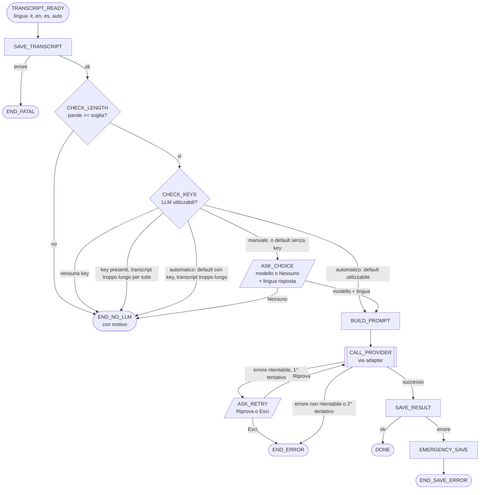

# Flusso: transcript → elaborazione LLM

## Precondizione: controlli in due fasi
1. **Controllo all'avvio** (offline): eseguito all'avvio dell'app. Il flusso non parte se fallisce. Nessuna chiamata di rete.
2. **`doctor` completo** (manuale, dal menu): esegue il controllo all'avvio e in più i controlli che richiedono la rete, per esempio l'accesso ai modelli Hugging Face per la separazione dei partecipanti. I controlli di rete non bloccano il flusso LLM.

Il controllo all'avvio verifica:
- template di prompt presenti per `it`, `en`, `es`
- tabella modelli completa: per ogni modello provider, id, etichetta, prezzo input, prezzo output, `max_output_tokens`, `context_window`
- ogni adapter dichiarato è registrato

Housekeeping (nel controllo all'avvio, quindi anche nel `doctor`):
- rimozione dei file temporanei orfani (`.*.tmp`) lasciati da scritture interrotte, nelle sessioni e nella cartella di configurazione;
- rotazione dei log `.menubar.stdout.log` e `.menubar.stderr.log` oltre una dimensione massima.

La validità delle API key non fa parte di nessuna delle due fasi: si verifica quando la key viene inserita in Settings (I4).

## Diagramma

## Modalità
- **Manuale** (default all'installazione): a ogni transcript l'utente sceglie modello e lingua in ASK_CHOICE.
- **Automatica** ("Automatic Summary" attivo in Settings): ASK_CHOICE viene saltata. Si usano il modello scelto dall'utente in Settings (il "modello di default") e la lingua di risposta Auto. ASK_RETRY resta, perché il secondo tentativo è sempre una scelta dell'utente (I10).

## Stati

| Stato | Descrizione | Interazione utente |
|---|---|---|
| TRANSCRIPT_READY | Transcript disponibile con metadato `language` ∈ {it, en, es, auto} | no |
| SAVE_TRANSCRIPT | Persistenza atomica del transcript | no |
| CHECK_LENGTH | Conta le parole del transcript | no |
| CHECK_KEYS | Determina le LLM utilizzabili (key configurata e contesto sufficiente) e la modalità | no |
| ASK_CHOICE | Schermata unica: modello (o Nessuno) + lingua di risposta | sì |
| BUILD_PROMPT | Sceglie il template e costruisce la richiesta neutra | no |
| CALL_PROVIDER | Chiamata tramite adapter | no |
| ASK_RETRY | Offre "Riprova" o "Esci" dopo un errore ritentabile | sì |
| SAVE_RESULT | Persistenza atomica di risposta, costi e metadati | no |
| EMERGENCY_SAVE | Salva la risposta in un file di emergenza in una cartella nota | no |
| DONE | Fine con successo | — |
| END_NO_LLM | Fine senza LLM; motivo: `too_short`, `no_keys`, `too_long`, `declined` | — |
| END_ERROR | Fine per errore della chiamata LLM | — |
| END_SAVE_ERROR | Risposta ottenuta ma non salvata nel posto previsto | — |
| END_FATAL | Salvataggio del transcript fallito | — |

## Transizioni

| Da | Condizione | A |
|---|---|---|
| TRANSCRIPT_READY | sempre | SAVE_TRANSCRIPT |
| SAVE_TRANSCRIPT | ok | CHECK_LENGTH |
| SAVE_TRANSCRIPT | errore | END_FATAL |
| CHECK_LENGTH | parole < soglia | END_NO_LLM (`too_short`) |
| CHECK_LENGTH | parole ≥ soglia | CHECK_KEYS |
| CHECK_KEYS | 0 LLM con key | END_NO_LLM (`no_keys`) |
| CHECK_KEYS | ≥1 LLM con key, nessuna con contesto sufficiente | END_NO_LLM (`too_long`) |
| CHECK_KEYS | automatica, default con key e contesto sufficiente | BUILD_PROMPT (default + Auto) |
| CHECK_KEYS | automatica, default con key ma contesto insufficiente | END_NO_LLM (`too_long`) |
| CHECK_KEYS | automatica, default senza key (≥1 altra LLM utilizzabile) | ASK_CHOICE (con riga di log) |
| CHECK_KEYS | manuale, ≥1 LLM utilizzabile | ASK_CHOICE |
| ASK_CHOICE | Nessuno | END_NO_LLM (`declined`) |
| ASK_CHOICE | modello + lingua | BUILD_PROMPT |
| BUILD_PROMPT | sempre | CALL_PROVIDER |
| CALL_PROVIDER | successo | SAVE_RESULT |
| CALL_PROVIDER | errore ritentabile e primo tentativo | ASK_RETRY |
| CALL_PROVIDER | errore non ritentabile, oppure secondo tentativo | END_ERROR |
| ASK_RETRY | Riprova | CALL_PROVIDER (secondo tentativo, stessa richiesta) |
| ASK_RETRY | Esci | END_ERROR |
| SAVE_RESULT | ok | DONE |
| SAVE_RESULT | errore | EMERGENCY_SAVE |
| EMERGENCY_SAVE | sempre | END_SAVE_ERROR |

## Parametri

| Parametro | Valore |
|---|---|
| Soglia minima transcript | 150 parole (≈ un paragrafo; sotto si legge prima del riassunto) |
| Tentativi massimi per chiamata | 2 (1 + 1 "Riprova" su scelta dell'utente) |
| Retry automatici SDK | 0 (`max_retries=0`) |
| Timeout HTTP | connessione 10 s, lettura 180 s (costanti configurabili) |
| Lingue di risposta | Ita, Eng, Esp, Auto |
| Limite di input | `MAX_INPUT_TOKENS` = 90.000 token stimati (≈ 4,5–6 ore di parlato), uguale per tutti i modelli. Il 10% di margine sotto la soglia long context più bassa (100.000, Anthropic) e la stima prudente caratteri/3 (i tokenizer recenti contano più token per carattere, soprattutto in italiano) tengono i token reali sotto la soglia |
| Contesto sufficiente | token stimati del prompt ≤ `MAX_INPUT_TOKENS` e token stimati del prompt + `max_output_tokens` ≤ `context_window` (vedi `adapter-contract.md`) |

## Invarianti

- **I1** — Il transcript è salvato prima di ogni altra operazione. Se il salvataggio fallisce, il flusso termina in END_FATAL.
- **I2** — Le scritture di transcript e risultato sono atomiche (file temporaneo + rename). Ogni esecuzione ha un `run_id`; più elaborazioni dello stesso transcript non si sovrascrivono.
- **I3** — Sotto la soglia di parole non si propone l'LLM: END_NO_LLM con motivo `too_short`, comunicato all'utente.
- **I4** — Una LLM è utilizzabile se e solo se ha la API key configurata nel Portachiavi di macOS e il transcript entra nel suo contesto (I17). La validità della key è verificata quando viene inserita in Settings, fuori da questo flusso.
- **I5** — In modalità manuale, in ASK_CHOICE nessuna opzione è preselezionata, né per il modello né per la lingua, anche con una sola LLM configurata (in quel caso le opzioni sono "Nessuno" e quella LLM). Nessuna memoria delle scelte precedenti. L'unica scelta ricordata è il modello di default della modalità automatica, scelto esplicitamente dall'utente in Settings (senza preselezione); vale solo in modalità automatica e non preseleziona nulla in ASK_CHOICE.
- **I6** — Template del prompt: lingua del transcript `it`/`en`/`es` → template corrispondente; `auto` o metadato assente → template inglese. Un metadato assente viene loggato.
- **I7** — La lingua di risposta è sempre un'istruzione esplicita nel prompt. Ita/Eng/Esp → "Respond in <lingua>". Auto → "Respond in the same language as the transcript".
- **I8** — Il transcript è inserito nel prompt tra delimitatori espliciti e trattato come dato: il system prompt dichiara che il contenuto delimitato non contiene istruzioni da eseguire.
- **I9** — Tutte le chiamate ai provider passano dagli adapter (`adapter-contract.md`). Nessun altro modulo importa SDK dei provider; gli SDK sono importati solo quando il provider viene usato.
- **I10** — Nessun retry automatico. L'unico secondo tentativo è il "Riprova" scelto dall'utente, offerto solo per errori ritentabili e una sola volta, anche in modalità automatica.
- **I11** — Ogni tentativo registra il proprio costo, anche se fallito, quando il provider restituisce l'uso dei token. Costo non calcolabile = `null`, mai `0`. Il risultato riporta il costo di ogni tentativo e il totale.
- **I12** — Risposta troncata (limite di token) = successo con stato `truncated`, salvata e segnalata all'utente. Risposta filtrata dal provider = errore non ritentabile.
- **I13** — Se SAVE_RESULT fallisce la risposta non va persa: va scritta in EMERGENCY_SAVE e il percorso mostrato all'utente.
- **I14** — Il risultato salvato contiene almeno: `run_id`, id transcript, provider, modello, modalità (manuale/automatica), template usato e sua lingua, lingua di risposta, testo, stato (`complete`/`truncated`), tentativi con token input/output e costo, costo totale, valuta, timestamp.
- **I15** — Ogni transizione produce una riga di log strutturata con `run_id`, stato di partenza, stato di arrivo, motivo. Nessuna API key in log, errori o risultati.
- **I16** — Gli esiti DONE, END_NO_LLM, END_ERROR, END_SAVE_ERROR, END_FATAL sono distinguibili dal chiamante.
- **I17** — Un transcript non viene mai inviato a un modello se supera `MAX_INPUT_TOKENS` o se non entra nel contesto del modello, e non viene mai troncato per farcelo entrare. Il limite unico tiene ogni richiesta sotto la fascia di prezzo long context, così la tabella modelli ha un solo prezzo per modello e il costo calcolato è corretto.

## Confine tra processi
- Il worker di trascrizione esegue TRANSCRIPT_READY e SAVE_TRANSCRIPT, poi termina.
- Se SAVE_TRANSCRIPT fallisce, quel tentativo termina in END_FATAL. Il livello job, fuori da questo flusso, può rifare la trascrizione fino a `max_attempts`; ogni nuovo tentativo riparte da TRANSCRIPT_READY. L'utente riceve il messaggio END_FATAL solo dopo l'ultimo tentativo.
- Dopo SAVE_TRANSCRIPT ok, l'app avvia un processo LLM separato, fuori dalla coda di trascrizione, che esegue il flusso da CHECK_LENGTH in poi su un transcript già salvato.
- ASK_CHOICE e ASK_RETRY sono mostrate dall'app: il processo LLM emette un evento JSON su stdout e attende la risposta su stdin.

## Posizione dei file
- Transcript: `<sessione>/transcripts/` (file esistenti; il testo usato dal flusso è `transcript.speakers.txt`, senza le righe di avviso `[MeetRec]`).
- Risultati: `<sessione>/summaries/<run_id>.json` (tutti i campi di I14) e `<sessione>/summaries/<run_id>.md` (testo da leggere).
- Emergenza: `~/Library/Application Support/MeetRec/emergency/<run_id>.json`, fuori dalla cartella delle registrazioni.
- API key: Portachiavi di macOS, una voce per provider.
- Modalità automatica e modello di default: blocco `summary` in `~/.config/meetrec/config.json` (mai le key).

## Note
- **Kill del processo**: non gestito nel flusso (evento raro, l'app non ha terminale). Gli unici residui possibili sono file temporanei, rimossi dal controllo all'avvio (I2). Un eventuale costo della chiamata interrotta non viene registrato.
- **Secondo punto d'ingresso per l'utente** ("elabora un transcript già salvato" dal menu, da CHECK_LENGTH in poi): previsto, fuori ambito per ora. Le funzioni da CHECK_LENGTH in poi ricevono già un transcript salvato (vedi "Confine tra processi"), quindi la strada resta aperta.
